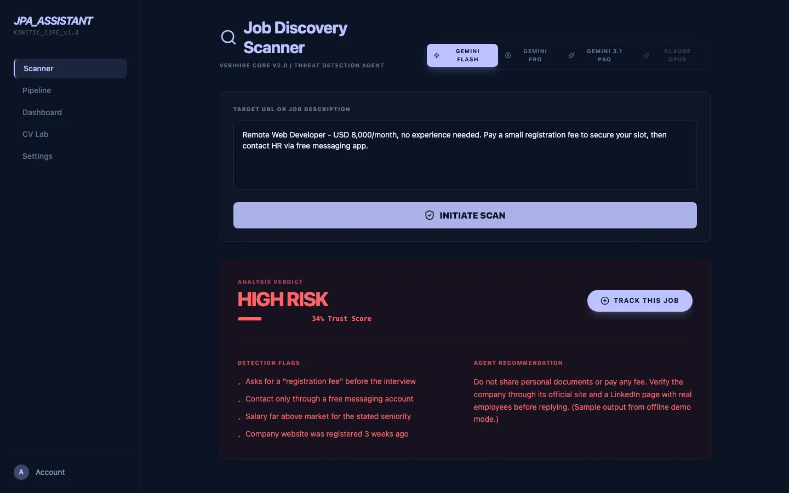
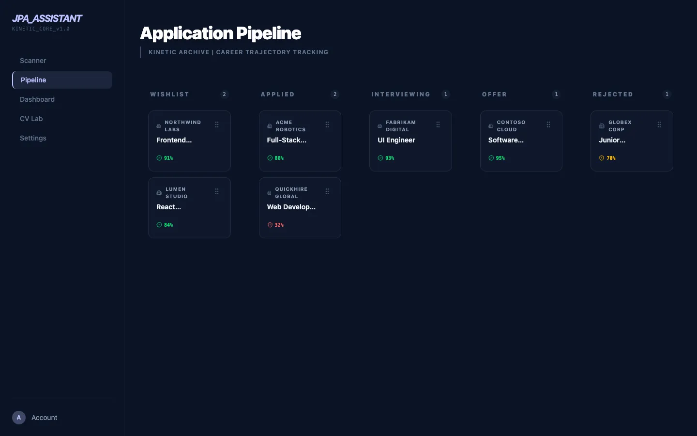
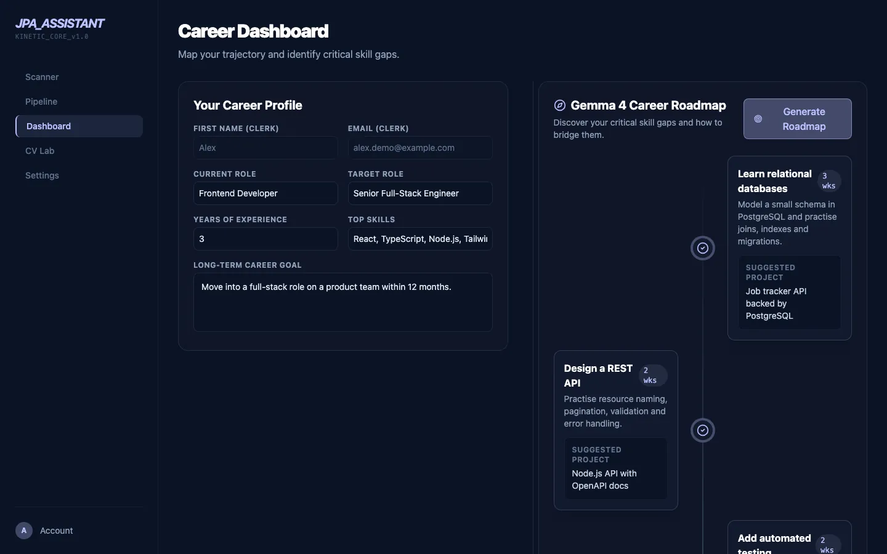
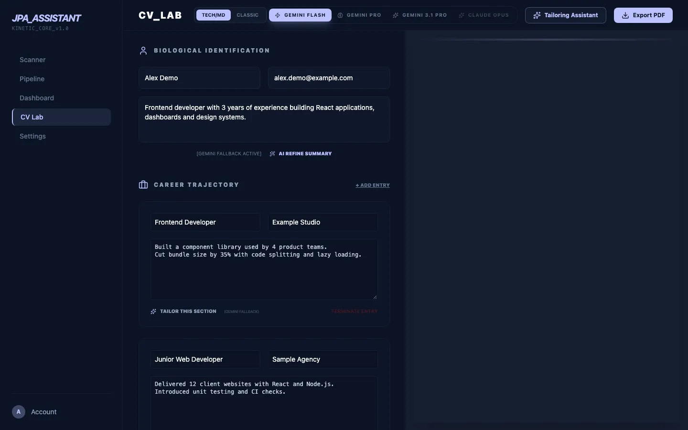
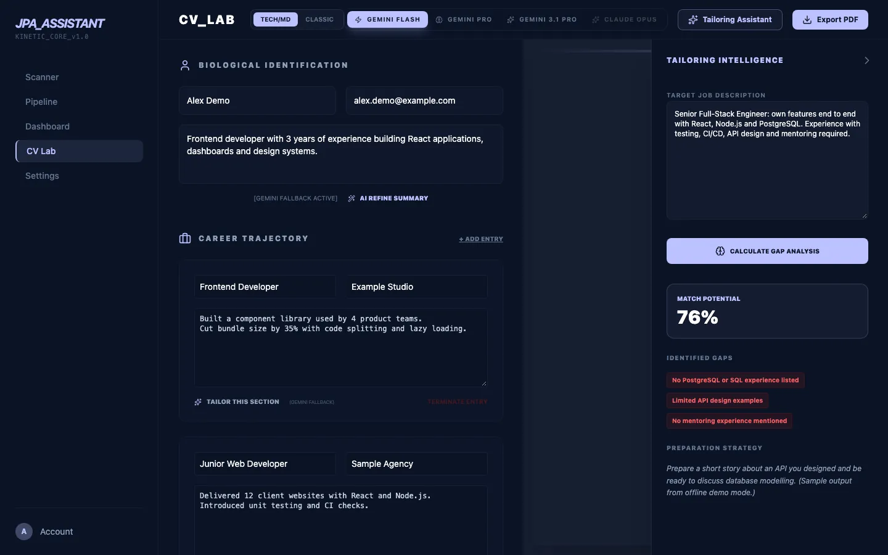
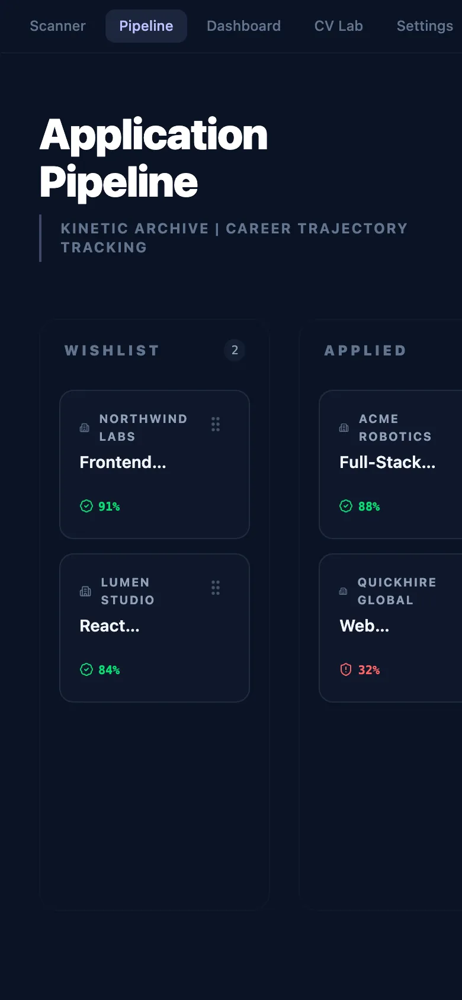

# 🚀 JPA Assistant (Jobseeker Personal Assistant)

**JPA Assistant** is a premium, AI-powered career companion designed to revolutionize the job-seeking experience. By integrating advanced Large Language Models (LLMs), it provides job seekers with the tools they need to navigate the modern job market with confidence and precision.

> **Live demo: currently offline** (the hosted deployment is paused). Run it locally with the offline demo mode below.

---

## 📸 Screenshots

Captured in offline demo mode with fictional sample data.

| | |
| :--- | :--- |
| <br>Job scanner: fraud verdict, trust score and red flags | <br>Kanban application pipeline |
| <br>Career profile and AI roadmap | <br>CV Lab with live PDF preview |
| <br>CV vs job description gap analysis | <br>Mobile (390 px) |

---

## 📖 What is JPA Assistant?

JPA Assistant (Jobseeker Personal Assistant) is a comprehensive platform that acts as an intelligent intermediary between candidates and their career goals. It leverages AI to analyze, optimize, and secure every step of the job application process. Whether you're verifying the legitimacy of a job post or fine-tuning your resume for an ATS (Applicant Tracking System), JPA Assistant is your dedicated digital coach.

## 🎯 Purpose

The primary mission of JPA Assistant is to **democratize high-end career coaching**.
*   **Protection**: Shielding users from predatory or fraudulent job postings through AI-driven fraud detection.
*   **Optimization**: Helping candidates translate their experiences into the language of recruiters.
*   **Efficiency**: Reducing the time spent on manual resume tailoring and job analysis.
*   **Intelligence**: Providing data-driven insights into how well a candidate fits a specific role.

---

## ✨ Current Features

### 🤖 Intelligent AI Infrastructure
*   **Dynamic AI Router**: Seamlessly switches between **Google Gemini** and **Anthropic Claude** based on availability and preference.
*   **Smart Fallback Logic**: Automatically detects missing API keys or rate limits and routes requests to the next available model to ensure zero downtime.
*   **Rate Limit Management**: Built-in "Cool Down" detection to handle AI provider constraints gracefully.

### 🔍 Career Tools
*   **Smart Job Scanner**:
    *   Extracts text directly from job URLs.
    *   Scores vacancies for legitimacy and quality.
    *   Flags potential red flags for "Expert HR Fraud Investigation."
*   **CV Analysis & Matching**:
    *   Deep-dive comparison between resumes and Job Descriptions (JD).
    *   Provides match scores and actionable feedback on strengths and gaps.
*   **Linguistic Excellence Engine**:
    *   Polishes resume sections using impactful action verbs and professional terminology.
*   **PDF CV Export**:
    *   Generates professional, print-ready resumes directly from the application.

### 🎨 Design & Experience
*   **Modern Aesthetics**: Built with a "Glassmorphic" design system, utilizing vibrant gradients and sleek dark modes.
*   **Fluid Animations**: Powered by **Framer Motion** for a high-end, responsive feel.
*   **Real-time Feedback**: Interactive "Toasts" and status indicators for AI operations.

---

## 🛠 Tech Stack

*   **Frontend**: React 19, Vite, Redux Toolkit
*   **Styling**: Tailwind CSS 4, Framer Motion
*   **AI Providers**: Google Generative AI (Gemini), Anthropic SDK (Claude)
*   **Utilities**: Axios, Cheerio (Web Scraping), Lucide React (Icons), React PDF

---

## 📅 Feature Track & Updates

| Date | Update | Description |
| :--- | :--- | :--- |
| **2026-04-24** | **Documentation Refresh** | Initial comprehensive project documentation and feature mapping. |
| **2026-04-18** | **AI Router Refactor** | Implemented model-agnostic architecture with dynamic fallback support. |
| **2026-04-10** | **CV PDF Engine** | Integrated `@react-pdf/renderer` for professional document generation. |
| **2026-04-08** | **Core AI Services** | Initial launch of Job Detection and CV Matching services. |

---

## 🚀 Run locally

Requires Node.js 20+ and npm.

```bash
git clone https://github.com/seppam/job-personal-assistant.git
cd job-personal-assistant
npm install
```

### Option A: offline demo (no accounts, no API keys)

```bash
npm run dev:demo
```

Open the printed local URL (default http://localhost:5173). Demo mode (`VITE_DEMO_MODE=true`, see `.env.demo`) skips Clerk sign-in, loads fictional sample data and returns canned results for the scanner, CV analysis and roadmap. No network calls are made to AI providers.

### Option B: full app with your own keys

> **AI features need your own API key.** The scanner, CV analysis, polishing and roadmap call Google Gemini or Anthropic Claude directly from the browser; no key is bundled with this repository. Sign-in uses Clerk, so a Clerk publishable key is also required.

Create `.env.local` (git-ignored) and add your own values:

```env
VITE_CLERK_PUBLISHABLE_KEY=your_clerk_publishable_key
VITE_GEMINI_API_KEY=your_key_here
VITE_ANTHROPIC_API_KEY=your_key_here   # optional
```

```bash
npm run dev
```

Other scripts: `npm run build`, `npm run lint` (there is no test suite yet).

---
*Built with ❤️ for the future of work.*
